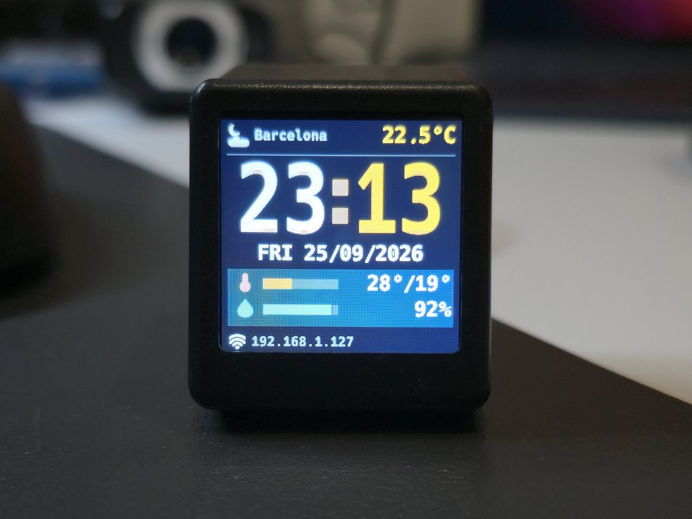

# 0. Welcome to your SmallTV Ultra

> This is a personal experiment, not a product. No warranty. You can brick your device. Recovery requires the
> built-in web updater; if the device does not boot, you need to open it and use a UART adapter.

Someone gave you a **GeekMagic SmallTV Ultra**: a 1.5-inch screen in a tiny TV-shaped case, with a Wi-Fi chip
inside. This page explains what it is, what it can and cannot do, which options you have, and how to hand the rest
over to an AI assistant that can install a new firmware and build things for you.

It has two readers:

- **You**: sections 1 to 6, about ten minutes.
- **Your AI assistant** (Claude Code, Codex or similar): [section 7](#7-for-ai-assistants-read-this-before-touching-the-device)
  tells it what to read, in which order, and which rules it must follow.

<p align="center"></p>

## 1. What it is

A small always-on display. It has no buttons, no battery and no sound: you plug it into a USB charger, it joins your
Wi-Fi and it shows things. Everything else (settings, photos, updates) happens on a web page that the device serves
itself, which you open from any phone or computer on the same network.

## 2. What it does, what it does not do, and what it could do

### Out of the box (factory firmware)

According to GeekMagic's manual, the factory firmware shows the time in several styles, the current weather and a
three-day forecast for your city, and a photo album with JPG images and animated GIFs (240×240 pixels). Depending on
the factory version it also has a countdown or a short custom text. You set it up from its own web page.

### What it cannot do (hardware limits)

- **No buttons and no touch screen.** (The firmware below adds an experimental *hand detection*: hold your hand
  over the base for two or three seconds to change the screen or the brightness.)
- **No Bluetooth, no speaker, no microphone, no camera.**
- **No sensors.** The temperature on the screen is the outdoor temperature from the internet, not your room's.
- **The USB-C connector only provides power.** There is no data connection: you cannot program it with a cable
  without opening the case.
- **2.4 GHz Wi-Fi only**, not 5 GHz.
- **No battery**: it is off when unplugged.
- **Very little memory** (80 KB of RAM): no video, no web browsing, no heavy computation on the device itself.

### What it can do with the smalltv-ultra firmware and a computer

The firmware described in this repository keeps the clock, weather, forecast and photo album, and adds a small HTTP
API. The idea is simple: **a program on your computer gathers the data and composes a screen (a "panel"); the device
only draws it.** The device never fetches anything by itself except the weather and the time.

| What you see on the device | How | Ready to use? |
|---|---|---|
| Clock, weather, forecast, photos and animated GIFs | built into the firmware | yes |
| Your computer's CPU, memory and disk use | [`clients/node/pc-stats.mjs`](../clients/node/pc-stats.mjs) | yes |
| What your AI coding agent is doing: working, idle, or waiting for you | [`clients/node/ai-status.mjs`](../clients/node/ai-status.mjs), fed by the agent's hooks | yes |
| Today's agenda from any `.ics` calendar | [`clients/node/agenda-ics.mjs`](../clients/node/agenda-ics.mjs) | yes |
| News headlines from any RSS or Atom feed | [`clients/node/news-rss.mjs`](../clients/node/news-rss.mjs) | yes |
| A message from your AI assistant ("tests passed", "lunch is ready") | the [MCP server](../clients/node/mcp/README.md) | yes |
| A server or website monitor | a few lines with the `Panel` builder of [`smalltv.mjs`](../clients/node/smalltv.mjs) | example in [`clients/node/README.md`](../clients/node/README.md) |
| Your AI usage of the day (tokens, cost, limits) | a script that reads your usage and sends a gauge | idea |
| Messages from a Telegram or Slack bot | the bot runs on your computer and shows what it receives | idea |
| Who is connected to your home network | a network scan from your computer | idea |
| Build or CI status, stock or crypto prices, the next bus, a holiday countdown, home automation alerts | a small script per idea | idea |

Two things to keep in mind:

- **The program that sends the data has to be running.** If your laptop sleeps, its panels expire and the device
  goes back to the clock. For something that should run all day, use a computer that is always on (a Raspberry Pi,
  a home server).
- **The device does not run these programs itself.** With this firmware it cannot host a chatbot or scan your
  network on its own; your computer does the work and the device is the screen.

## 3. Your three options

| | **A. Keep the factory firmware** | **B. Install smalltv-ultra** (recommended) | **C. Write your own firmware** |
|---|---|---|---|
| What you get | clock, weather and album, as GeekMagic designed them | everything in section 2: built-in screens, an HTTP API, ready-made clients and an MCP server for AI assistants | anything that fits in 80 KB of RAM |
| Effort | none | about 20 minutes, two uploads, with your AI assistant guiding you | days, and you need to know ESP8266 programming |
| Risk | none | low: every upload is checked before it is applied, and there is a rescue mode. Still an experiment | high: one image without a working updater means opening the case |
| Going back | — | only with your own copy of the factory firmware (it is not distributed here) | depends on what you build |

**A. Factory firmware.** Fine if a clock and the weather are all you want. GeekMagic publishes its manual and its
updates at [GeekMagicClock/smalltv-ultra](https://github.com/GeekMagicClock/smalltv-ultra). Some community projects
send images to the factory firmware without replacing it, for example the Home Assistant integration
[adrienbrault/geekmagic-hacs](https://github.com/adrienbrault/geekmagic-hacs).

**B. smalltv-ultra** ([github.com/u1pns/smalltv-ultra](https://github.com/u1pns/smalltv-ultra), this repository).
You keep a working clock and weather, and anything else you want to show is a small script that your AI assistant can
write and run on your computer: experiments are cheap, and nothing on the device has to be reprogrammed for each new
idea. Its core is built so that **the device can always receive a new firmware image over Wi-Fi**, and it has a rescue
mode reachable with three short power cuts. The firmware's source code is not published: you customise it from
outside (panels, settings, photos), not by changing its code.

**C. Your own firmware.** The device is an ordinary ESP8266, so Arduino, PlatformIO or ESPHome can target it. Useful
starting points: the [ESPHome device page](https://devices.esphome.io/devices/geekmagic-ultra/) (pinout and a
reference configuration) and the open projects [Times-Z/GeekMagic-Open-Firmware](https://github.com/Times-Z/GeekMagic-Open-Firmware)
and [giovi321/smalltv-mod](https://github.com/giovi321/smalltv-mod). Before you start, know three things:

- Without a data cable, **your first image has to go in through a web updater**. The factory updater only accepts
  small images (that is why option B needs a jailbreak image first).
- The smalltv-ultra updater only accepts images whose bootloader is identical to the installed one, so an image built
  with another toolchain may be refused. A refused upload changes nothing.
- **Once your own firmware is installed, the only way to update it is the updater your firmware includes.** If it has
  none, or it breaks, you have to open the case and use a UART adapter.

A sensible path is to start with B and move to C only if you outgrow it.

## 4. Technical specifications

| | |
|---|---|
| Model | GeekMagic SmallTV Ultra (the ESP8266 version; not the SmallTV Pro or other GeekMagic models) |
| Size | 35 × 39 × 45 mm |
| Display | 1.5-inch IPS, 240×240 pixels, ST7789V controller |
| Processor | ESP8266EX on an ESP-12F module: one 32-bit core at 80 MHz (160 MHz possible) |
| Memory | 80 KB of data RAM, no PSRAM. A full-screen image (115 KB) does not fit in memory, so screens are drawn line by line |
| Flash | 4 MB: the firmware image, plus about 2 MB of internal storage for fonts, icons, photos and panels |
| Wi-Fi | 802.11 b/g/n, 2.4 GHz only |
| Bluetooth, sound, sensors, buttons | none |
| Power | 5 V DC, 1 A or more, through USB-C. Power only, no data |
| Serial port | not accessible from outside: the pads are inside the case |

Sources: GeekMagic's user manual (size, display, power) and measurements on a real unit.

## 5. First step: get it on your Wi-Fi with the factory firmware

1. **Power it** from a USB charger of 5 V and at least 1 A, with the cable that came in the box (USB-A to USB-C).
   GeekMagic's manual says USB-C to USB-C cables are not supported; a flickering screen, or no screen at all, is
   usually the cable or the charger. Put it where your Wi-Fi signal is good.
2. **On its first start it creates an open Wi-Fi network called `GIFTV`.** Join it with your phone. Ignore the "no
   internet" warning; if the next step does not load, turn off your phone's mobile data.
3. **Open `http://192.168.4.1/`.** On the Wi-Fi settings (the *Network* or *System* tab, depending on the factory
   version), press *Scan*, choose your home network, type its password and save. Use the network your computer is on,
   not a guest network. If your network is not in the list, it is probably 5 GHz only: the device needs 2.4 GHz
   ([Wi-Fi requirements](03-features.md#wi-fi-what-the-device-needs)). The device restarts.
4. **Write down the address it shows on the screen while it starts** (something like `10.0.0.42`). You and your AI
   assistant will need it, and it can change from one day to another.
5. **From a computer on the same Wi-Fi, open `http://<that address>/`.** That is the factory web page: choose your
   city and time settings and try the device as it is. The page usually shows the factory firmware version too (for
   example `Ultra-V9.1.54`); note it down.

If it never joins your network, try again from step 2. Other projects report that three quick power cuts during the
factory boot progress bar make it forget the saved Wi-Fi and bring the `GIFTV` network back.

One security note: other projects report that the factory firmware hands out the saved Wi-Fi password, without any
login, to anyone on the same network ([details](01-jailbreak.md#coming-from-the-factory-firmware-two-things-to-know)).
The smalltv-ultra firmware never does.

## 6. Next step: hand it to your AI assistant

You need:

- **An AI assistant that runs on your computer and can run commands**, such as Claude Code or the Codex CLI. A chat
  in a web browser cannot reach a device on your home network.
- That computer on the same Wi-Fi as the device, with `git`, `curl` and, for the ready-made clients and the MCP
  server, Node.js 18 or newer.
- Your phone, for one step in the middle.

Open your assistant in an empty folder and paste this, with the address from step 4:

```text
Clone https://github.com/u1pns/smalltv-ultra and read docs/00-introduction.md, starting with section 7,
then everything that section tells you to read.
My SmallTV Ultra runs its factory firmware and is on my Wi-Fi at <address shown on its screen>.
Install the smalltv-ultra firmware: the jailbreak image, then the application, then the resource pack.
Check the MD5 of every file, tell me what you are about to upload and wait for my OK before each upload.
When it works, set up the MCP server and suggest a few things I could show on the device, based on what I do.
```

What to expect: the assistant uploads the jailbreak image, and the device **leaves your network on purpose**. The
assistant then asks you to join the device's own Wi-Fi from your phone, connect the device back to your home Wi-Fi
(the same network as your computer), and upload the application from your computer's browser. From that point on the assistant can talk to the
device by itself, and the rest (resources, settings, your first panels) is a conversation.

If you prefer to do it by hand, follow the [Quick start](../README.md#quick-start) instead.

## 7. For AI assistants: read this before touching the device

You are helping someone install and use this firmware on a GeekMagic SmallTV Ultra. The device's **web updater is
the only way into it and the only way back**: there is no usable cable, and a device that does not boot can only be
recovered by opening the case. Everything below exists to keep that updater working.

### Read, in this order

1. [`../README.md`](../README.md): *Read this before you flash anything* and *Quick start* (the stage and login table).
2. [`../firmware/README.md`](../firmware/README.md): which files exist, which ones the user needs, and the
   `manifest.json` of each folder (sizes and MD5).
3. [01-jailbreak.md](01-jailbreak.md) and [02-install-firmware.md](02-install-firmware.md).
4. [04-recovery.md](04-recovery.md) and [troubleshooting.md](troubleshooting.md).
5. Once the application runs: [05-pc-apps.md](05-pc-apps.md), [api/API.md](api/API.md),
   [api/PANEL-API.md](api/PANEL-API.md), the README of the client folder that fits the user's computer
   ([mac](../clients/mac/README.md), [windows](../clients/windows/README.md), [node](../clients/node/README.md)) and
   [the MCP server](../clients/node/mcp/README.md).

### Rules

1. **Upload only the files in [`../firmware/`](../firmware/)**, the latest release folder, never an image built or
   found elsewhere. The exception is a user who explicitly chose option C and understands what can go wrong.
2. **Before every upload, and before formatting the storage**, tell the user what you are about to do and wait for
   their OK. For an upload, first compare the file's size and MD5 with its `manifest.json` and say which file, for
   which stage.
3. **One upload at a time.** Never ask for a power cut during an upload or a restart. Three starts in a row, each
   shorter than 60 seconds, put the application in rescue mode: that is expected, not a fault (see 04-recovery.md).
4. **Check the starting point** before the jailbreak: `GET /v.json` on the factory firmware answers with the model
   (`m`, it must be `SmallTV-Ultra`; anything else means stop) and the factory version (`v`). The project was
   developed on `Ultra-V9.1.54`, and a unit with `Ultra-V9.0.54` also accepted the jailbreak. Any other version is
   untested: tell the user before uploading. If `/v.json` does not answer, ask the
   user to read the version on the factory web page. If the factory updater refuses the jailbreak, nothing was written.
5. **Credentials depend on the stage**, all lowercase (phones capitalise the first letter on their own):
   factory page, none; jailbreak page, `admin` / `kapifo`; application, `admin` / `12345678`. The device's own access
   point `SmallTV-Setup-<chip-id>` uses the password `12345678`.
6. **Never hardcode or guess the IP address**: it comes from DHCP and changes. Use what the user reads on the screen
   or in the router, or UDP discovery once the application is installed (the `discover` command of each client
   folder). Fix an address in a configuration only if the user agrees, knowing it can change.
7. **Never expose the device to the internet**: no port forwarding, no public address. It speaks plain HTTP with
   public credentials.
8. **Do not join the device's access point from the computer you run on**: it would lose its internet connection,
   and you with it. That step is for the user's phone.
9. **Spare the flash**: prefer volatile panels for anything that changes often, and store a panel only when its
   content changes (rules in 05-pc-apps.md).
10. **Ask before changing anything on the user's computer that outlives this session**: hooks in the assistant's
    global settings, scheduled jobs, programs left running in the background. Say what it is and how to remove it.
11. **The firmware's source code is not in this repository.** Do not try to modify or rebuild it; build on its API.
    Some features in api/PANEL-API.md need a minimum application version: check the installed one (`GET /api/status`)
    before using them.

### Installation, step by step

| # | Who | What | How you know it worked |
|---|---|---|---|
| 1 | you | Check the model and the factory version: `curl -s http://<address>/v.json` (rule 4) | model `SmallTV-Ultra`, version noted and told to the user |
| 2 | you | Upload the jailbreak to the factory updater: `curl -F "firmware=@smalltv-ultra-jailbreak-v0.1.2.bin" "http://<address>/update"` | *Update Success! Rebooting...*, after up to about a minute: do not interrupt it |
| 3 | **the user, on a phone** | Join `SmallTV-Setup-<chip-id>` (password `12345678`), open `http://192.168.4.1/`, log in with `admin` / `kapifo`, and join the home Wi-Fi (*Conectar a tu Wi-Fi* → *Buscar redes* → *Conectar y guardar*). It must be **the same network as your computer**, never a guest network, and 2.4 GHz with a good signal ([requirements](03-features.md#wi-fi-what-the-device-needs)) | the page shows the device's new address; ask the user for it and check that it answers **from your computer** (`curl -s -u admin:kapifo http://<new address>/api/status`). If it does not, the device is on another network: the user rejoins `SmallTV-Setup-<chip-id>` and picks the right one |
| 4 | **the user, in the computer's browser** | Open the device's page at its new address (login `admin` / `kapifo`) and upload the application `.bin`: *Actualizar el firmware* → choose the file → type its MD5 in *MD5 del archivo* → *Verificar y actualizar*. Copy the file to a folder the user knows (their Downloads folder, for example) and give them that exact path and the MD5. The user does this step because the jailbreak page has its own login and no documented scripted upload, and the ready-made clients do not talk to it | *Verificado; reiniciando*, and the device comes back in about 15 seconds |
| 5 | you | Find the device with the `discover` command of a client folder; from now on the login is `admin` / `12345678` | discovery lists it with `mode=app` |
| 6 | the user, then you | The user opens *Advanced → Internal storage* and, if it says the storage is not formatted, presses *Format the storage* (usual on a new unit). Then you upload `smalltv-ultra-resources.res` with the `upload-resources` script of the mac or windows client folder, or the user does it from *Advanced → Update the firmware* | after about a minute, `GET /api/app/health` shows `"missing": []` |
| 7 | the user, then you | Optional language pack, from the web page (same field as the resource pack). Then the user's city, time zone and screens (web page, `settings` script, or the MCP server) | the screens show the right time and weather |
| 8 | you | Register the MCP server: `claude mcp add --scope user smalltv -- node <absolute path>/clients/node/mcp/server.mjs` (without `--scope user` it only works in the current folder; other assistants in its README). The user may need to restart the assistant to see the new tools. Then show a test panel | the test panel appears on the device |

Later updates are just the new application `.bin` from a newer release, through the `update-firmware` script or the
web page. If anything goes wrong, read 04-recovery.md before concluding the device is lost: a refused upload changes
nothing, and rescue mode is reachable without the web page.

### Then: suggest things to build

1. Ask the user three short questions: what they do at the computer all day, what they would like to glance at
   without opening anything, and where the device sits (desk, kitchen, living room).
2. Propose three to five ideas, mixing the ready-made clients in section 2 with new ones made for them. Start with a
   ready-made one, to prove that the whole path works.
3. Build new ideas as small programs on the user's computer that send panels, with
   [`../clients/node/smalltv.mjs`](../clients/node/smalltv.mjs) or the shell and PowerShell clients. Run them from the
   user's scheduler (launchd, cron, Task Scheduler) or from the assistant's hooks, and say what happens when the
   computer sleeps.
4. Respect the panel limits (details in api/PANEL-API.md): up to 8 rows of about 28 characters, printable ASCII plus
   the Spanish accented letters (anything else, emoji included, becomes `?`), and a `POST` body of at most 512 bytes.

## 8. Where to read more

| Document | What it covers |
|---|---|
| [README](../README.md) | Overview, warnings and the quick start |
| [01-jailbreak.md](01-jailbreak.md) | From the factory firmware to the jailbreak image |
| [02-install-firmware.md](02-install-firmware.md) | Installing and updating the application and the resource pack |
| [03-features.md](03-features.md) | Everything the firmware does |
| [04-recovery.md](04-recovery.md) | Rescue mode, and what cannot be recovered without a UART adapter |
| [05-pc-apps.md](05-pc-apps.md) | Sending screens from your computer |
| [troubleshooting.md](troubleshooting.md) | Common problems |
| [api/](api/API.md) | HTTP API, panel format and album uploads |

Before downloading anything, read the [DISCLAIMER](../DISCLAIMER.md).
